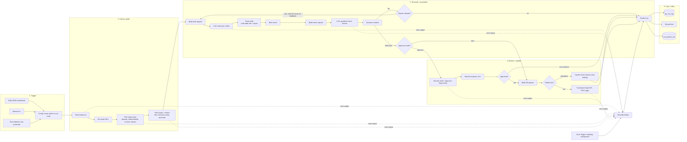

> Take-home assessment for PlacidWay (AI Automation Specialist), by Aaron Cabantugan. Sample workflow and documents only; no secrets are included (credential ids, hosts and keys are placeholders).

# PlacidWay daily Facebook post: n8n workflow

A take-home build for the AI Automation Specialist role at PlacidWay, by Aaron Cabantugan.

Once a day, the workflow picks one public PlacidWay page it has never used. It reads the page politely, writes a Facebook post with an LLM, and runs the post through two independent guardrails. Then it publishes the post, or sends it to a human reviewer first. Every run is logged, and every failure raises an alert.

- Platform: n8n 2.11 (self-hosted). Workflow file: `workflow.json`.
- LLMs: Anthropic Claude. Haiku writes the post, Sonnet checks it.
- Store and log: n8n Data Tables (`pw_posted_urls`, `pw_run_log`).
- Alerts and approvals: one Discord channel, through a webhook.
- Publish: Facebook Graph API to a test Page, behind a config flag. The flag defaults to **simulation** (posts nothing). The demo has also run in **live** mode against a Facebook TEST Page, "Aaron Automation Test" (run 102818, sample 9).
- Samples: `samples.md` holds 9 posts from real PlacidWay pages (8 simulated, 1 published live to the test Page), with source URLs and guardrail verdicts.
- Screenshots: `screenshots/`. The canvas images come from n8n's public workflow-preview component, rendered from `workflow.json`. The red warning icons in them only mean the preview has no credentials loaded. The dashboard images are the live run log.

## Architecture



The workflow has 52 nodes, sticky notes included. Most logic sits in small Code nodes with one job each, commented in plain English. The canvas is meant to be read left to right.

## Setup

1. **Import** `workflow.json` into an n8n version that has Data Tables (built and tested on 2.11.4). Set the workflow time zone to Asia/Manila (already in the file's settings).
2. **Create two Data Tables.** Every column is a string, except `attempts`, which is a number.
   - `pw_posted_urls`: url, content_type, title, status, run_id
   - `pw_run_log`: run_id, started_at, trigger, review_mode, publish_mode, content_type, url, title, image_url, fetch_source, post_text, rule_check, llm_check, attempts, fb_request, fb_post_id, status, error, finished_at

   Select the tables in the four Data table nodes (`Get used URLs`, `Log run`, `Remember URL (never repeat)`, `Get run log`).
3. **Create four credentials.** The names are what the nodes expect. The values never live in the workflow file.

   | Credential (type) | What goes in it | Used by |
   |---|---|---|
   | `PlacidWay assessment - Anthropic` (Header Auth) | name `x-api-key`, value = your Anthropic API key | both LLM nodes |
   | `PlacidWay assessment - Discord webhook` (Discord Webhook) | the reviewer channel's webhook URL. It is the only place the URL lives; to send alerts to another channel, edit this one credential, no node changes | approval message, alerts, run line |
   | `PlacidWay assessment - FB TEST page token (placeholder)` (Facebook Graph API) | a Page access token for a **test Page you own** | Facebook node (live mode only) |
   | `PlacidWay assessment - run webhook key` (Header Auth) | name `x-run-key`, value = any long random string | the test webhook |

4. **Open the Config node** and set `fb_page_id` (only needed for live mode) and `n8n_base_url` (used for the execution links in alerts).
5. In workflow settings, **set Error Workflow to this same workflow**. Its Error Trigger then catches anything the explicit error paths miss.
6. **Activate.** The 09:00 schedule starts, in simulation mode by default. Set `publish_mode: 'live'`, the Page id and the Page token to post to a test Page.

### Environment variables and configuration

n8n 2.x blocks `$env` inside nodes by default (`N8N_BLOCK_ENV_ACCESS_IN_NODE`). So the workflow keeps secrets in **credentials** and settings in **one Config node**, both of which travel safely with an export. Instance-level settings worth knowing:

| Name | Where | Value used here |
|---|---|---|
| `GENERIC_TIMEZONE` | n8n container | instance default; the workflow overrides it with Asia/Manila |
| `N8N_RUNNERS_ENABLED` | n8n container | `true` (Code nodes run in the task runner; `this.helpers.httpRequest` and `setTimeout` are used) |
| `N8N_RUNNERS_TASK_TIMEOUT` | n8n container | default 300 s is enough (the slowest node takes about 60 s in archive mode) |
| `ANTHROPIC_API_KEY`, `FB_PAGE_TOKEN`, `DISCORD_WEBHOOK_URL`, `RUN_WEBHOOK_KEY` | **n8n credentials**, not env | see the table above |

Config keys (in the `Config` node):

| Key | Default | Meaning |
|---|---|---|
| `review_mode` | `auto` | `auto` publishes straight away; `approval` sends the draft to a reviewer first |
| `publish_mode` | `simulation` | `simulation` logs the exact Graph API request and posts nothing; `live` posts to the test Page |
| `fb_page_id` | placeholder | your test Page id. Never a PlacidWay page. |
| `fb_graph_version` | `v27.0` | the version used in Meta's Pages API docs (checked 2026-11-10) |
| `schedule_minutes_ahead` | `0` | 0 = publish now; 15 to 43200 = schedule on Facebook (Meta allows 10 min to 30 days) |
| `min_delay_ms` | `1000` | the brief's 1 request per second; robots.txt `Crawl-delay` wins when larger (3 s today) |
| `archive_fallback` | `true` | read the Internet Archive copy when PlacidWay refuses the request (see below) |
| `rotation` | Mon article, Tue package, Wed Q&A, Thu article, Fri news, Sat package, Sun Q&A | the variety rule |
| `draft_model` / `checker_model` | `claude-haiku-5-5` / `claude-sonnet-5-5` | writer and reviewer models |
| `max_attempts` | `2` | first draft plus one rewrite with the checker's feedback |
| `approval_timeout_hours` | `24` | after this, the draft expires and nothing is posted |

## How to run

- **Daily:** activate the workflow. It runs at 09:00 Asia/Manila.
- **By hand:** open the workflow and click *Execute workflow* on the `Manual run` trigger. You can watch every node light up.
- **From a terminal (tests):** the `Test run (webhook)` trigger takes a JSON body that can override a few Config keys for one run.

```bash
curl -X POST "https://YOUR-N8N-HOST/webhook/placidway-assessment/run" \
  -H "x-run-key: YOUR_RUN_KEY" -H "Content-Type: application/json" \
  -d '{"review_mode":"approval","content_type":"article"}'
```

  Allowed overrides: `review_mode`, `publish_mode`, `content_type` (article, package, answer, news), `archive_fallback`, `override_url` (a PlacidWay URL, still checked against robots.txt and the used list) and `test_draft` (replaces the first draft, to demo the guardrails).
- **Dashboard:** `GET https://YOUR-N8N-HOST/webhook/placidway-assessment/dashboard?k=YOUR_DASHBOARD_KEY` shows every run as an HTML table, read-only. Without the right `k` it answers `401 Not authorised` and reads nothing. The key is a static value inside the `Check dashboard key` Code node (the exported file holds the placeholder `REPLACE_WITH_YOUR_DASHBOARD_KEY`; replace it with a long random string). It is a shared secret in a URL, not real authentication: it keeps the run log from being world-readable, but anyone who sees the URL has access. Rotate or remove the dashboard branch after the assessment.

## Extraction: method and why

**Method: the XML sitemaps, then plain HTML parsing of one page.** No RSS, no headless browser.

- robots.txt declares `Sitemap: https://www.placidway.com/sitemap.xml`, a sitemap index of 72 child sitemaps. Four of them map to the content the brief names: `/1/sitemap_articles.xml` (about 5,100 blog articles), `/1/sitemap_packages.xml` (about 3,800 treatment packages), `/sitemap/1/sitemap_answers.xml` (about 4,500 patient Q&A pages) and `/1/sitemap_news.xml` (about 720 news items). Counts are from the 2026-10-05 copy.
- A sitemap is the site owner's own list of what it wants crawled. It covers packages and Q&A, which a blog RSS feed would not. It also carries the image URL for each article. One request returns every candidate, so the request count stays tiny.
- Pages are server-rendered HTML with clean `og:title`, `og:description`, `og:image` and canonical tags, and the body sits in one container (`article-dt-desc`). A headless browser would add cost and load for nothing.
- **Recency:** PlacidWay regenerates `lastmod` on every article and package each day, so `lastmod` says nothing about age there. The numeric content id (`/article/9789/...`) is an auto-increment, so the workflow ranks by id, newest first. News items do have real `lastmod` dates, and the workflow uses them.
- Each run costs PlacidWay **3 requests on a normal day**: robots.txt, one sitemap and one page. If a page can't be read, it tries the next one, up to 5 pages, so the hard ceiling is 7 requests per run. Requests are sequential and at least 3 seconds apart.
- **Featured image:** `og:image`, else the sitemap's `image:loc`. The workflow uses the original S3 URL (`placidwaycdn.s3.amazonaws.com`) so that Facebook can always fetch the image.
- **Package price:** the package's own "Price starting from" block, so the guardrails can tell a real price from an invented one. Prices of related packages lower on the page are not counted as source text.

### robots.txt (fetched 2026-11-10)

- `User-agent: *` (and named AI crawlers such as GPTBot, ClaudeBot and PerplexityBot) share one rule group. It begins `Allow: /`.
- **Disallowed** paths include `/admin/`, `/api/v1/`, `/ajax/`, `/uploads/`, `/language/`, `/rfi/`, `/write-review/`, `/video/5469/`, `/solutions/`, `/data/`, `/common/`, `/test/`, `/old/` and `/blog_old/`, 64 Disallow lines in all, mostly system and asset folders. `/cdn-cgi/image/*` is allowed.
- `Crawl-delay: 3`. The workflow honours it: at least 3 s between any two requests to PlacidWay, which is stricter than the brief's 1 per second. The gap holds across nodes: each fetching node (`Read robots.txt`, `Pick today's item`, `Fetch page + extract`) passes a per-host `fetch_clock` (time of the last request) and a `req_log` to the next node, so the next fetch waits out the remainder of the 3 s. Proof: execution 102808 logged `/robots.txt` at 09:24:17.341Z and the sitemap at 09:24:20.341Z (3.000 s apart). Internet Archive requests are a different host and use their own 1.1 s gap. In that run PlacidWay's Cloudflare answered the sitemap with 403, so the page itself came from the archive copy; the live page fetch uses the same clock but could not be shown from this server's IP.
- `Sitemap: https://www.placidway.com/sitemap.xml`.
- The `Read robots.txt` node fetches and parses the file on every run, with group matching, longest-match-wins and `*` / `$` wildcards. The workflow checks every sitemap and page URL against the file before fetching it. If robots.txt can't be read, the run stops and alerts. Run 102788 shows a disallowed URL (`/admin/`) refused before any request went out.
- User-Agent: `PlacidWayAssessmentBot/1.0 (take-home demo; one post per day; respects robots.txt)`.

### Honest note: PlacidWay's Cloudflare blocks this server

robots.txt loads fine, but every other PlacidWay URL returns **HTTP 403 (Cloudflare "Sorry, you have been blocked")** to the VPS this n8n runs on. This happens for any honest User-Agent. Cloudflare commonly blocks datacenter IP ranges. I did not try to get around it: no browser User-Agent spoofing, no proxies.

Instead, when the live site answers 403, the workflow switches to `archive_fallback`. It reads the **Internet Archive's copy** of the same sitemap and page (`web.archive.org/web/<timestamp>id_/<url>`, the raw original HTML) and puts zero load on PlacidWay. The newest pages are usually not archived yet. In that case, the workflow walks down the ranking in growing steps and takes the newest page the archive holds. The log records `fetch_source` (live, or archive plus the snapshot date) on every run. The post always links to the live PlacidWay URL.

From an office or home connection, the live site answers. The fallback then never fires, and the workflow takes the newest item. With PlacidWay's go-ahead, the clean fix is to allowlist the bot's User-Agent or IP in Cloudflare.

## Selection and "never the same URL twice"

- `Get used URLs` reads `pw_posted_urls`. `Pick today's item` removes those URLs, removes anything robots.txt disallows, and ranks the rest newest first.
- `Finalize run` remembers a URL once it was simulated, published, scheduled, rejected by the reviewer, or blocked by the guardrails for content reasons. A failure (site down, API error) does not burn the URL, so the next run can try it again. Neither does a block caused only by a formatting slip.
- Tested: run 102784 picked the next package after 102776 used package 8072. Run 102787 forced 8072 again through `override_url`, and the workflow refused it with "already used on an earlier run" plus an alert.

## Generation

- **Haiku** gets the title, meta description, the listed price (packages only) and up to 7,000 characters of page text. It has to return JSON only: `{hook, lines[2-3], cta, hashtags[3-5]}`. The prompt carries the hard rules and a per-type angle. A package post covers what the package includes, a Q&A post opens with the question, and so on.
- **Code, not the model, assembles the post:** hook, blank line, value lines, blank line, CTA, blank line, the canonical URL, blank line, hashtags. So the model can never invent or mistype the link, and the layout is always the same.
- **Code enforces length.** If the text before the link reaches 500 characters, the workflow drops trailing value lines, never below 2. Code never adds text. Runs 102778 and 102779 were blocked for length, because Haiku does not count characters reliably. That led to this fix, and the same URLs then passed (runs 102782 and 102783).

## Guardrails: two independent checks, both must pass

**Check 1, rules (`Rule check` Code node).** Deterministic, cheap and explainable. A compliance person can read the word list and extend it.

1. Structure and length: hook present, 2 to 4 lines, CTA, 3 to 5 alphanumeric hashtags, under 500 characters before the link, no URL written by the model, no emoji.
2. Medical claims and outcome promises, by regex: guarantee, 100%, risk-free, pain-free / painless, permanent, miracle, life-changing, "transform your", instant / perfect / best results, cure / curing, "will / can / to heal, fix, reverse, eliminate, restore, regenerate", proven / clinically proven, success / survival rate. The rules scan hashtags too, so `#MiracleCure` counts.
3. **Every number must appear in the source.** Any figure in the post, prices included (`$4,999`, `98%`), must exist in the page text. A missing currency figure is tagged `invented_price`, any other missing number `unsupported_fact`. Percentages are refused even when the source has them, because rates and odds read as promises.
4. Superlatives and rankings ("best", "top", "leading", "world-class", "#1" and so on) are allowed only when the source itself uses them.

**Check 2, a second LLM pass (`LLM: guardrail check (Sonnet)`).** A stronger model reads the draft against the full source as a strict compliance reviewer. It fails the draft for `medical_claim`, `outcome_promise`, `invented_price` or `unsupported_fact`, and returns JSON with the exact quote and a reason for each issue. It catches what a word list can't: softened promises ("can help you finally..."), paraphrased facts the page does not support, and claims about the wrong treatment or place. It **fails closed**: an unreadable reply counts as a fail.

**Why both:** the rules are predictable and free, but blind to meaning. The LLM understands meaning, but can drift. A post goes out only if both say yes. On a fail, the issues from both checks go back to the writer for **one rewrite**. If the rewrite fails as well, the workflow blocks the post, alerts the reviewer and posts nothing.

**Example of a blocked draft** (run 102791; the first draft was injected through `test_draft` on purpose):

```text
Finally, a cure for failed back surgery!

Revision surgery in Mexico is guaranteed to fix a failed spinal fusion.
Packages start at just $4,999 with a 98% success rate.
Mexico has the best spine surgeons in the world.

Book today and walk pain-free next month.

#BackPain #MiracleCure #Mexico
```

- The rule check caught: `guaranteed`, `pain-free` (outcome_promise); `cure`, `to fix`, `success rate` (medical_claim); `$4,999` (invented_price, not on the page); `98%` (unsupported_fact).
- The LLM check caught all of that, plus three things the rules missed. The page was about donor-egg IVF in Cyprus, not back surgery. "The best spine surgeons in the world" is an unsupported ranking. `#MiracleCure` implies a cure. (After this run, the rules also scan hashtags.)
- The rewrite used only the page's own figures ("Cyprus donor egg IVF costs $5,500 to $7,500 for a complete cycle") and passed both checks. Sample 6 in `samples.md` shows the result.

## Review option (approval mode)

With `review_mode = approval`, `Build approval message` posts the draft to the reviewer channel. The message holds the source link, the image, both guardrail verdicts and two links: **Approve** and **Reject**. Both links are this run's own n8n Wait-node resume URL, with `?action=approve` or `?action=reject`. The run pauses on `Wait for reviewer` (24 h limit) and continues the moment someone clicks.

- Approve leads to the publish step. Reject leads to `rejected`. No click within 24 h leads to `expired`. In both of the last two cases nothing is posted.
- Link previews can "click" links. The links sit in `<...>` so that Discord does not unfurl them, and the Wait node has *Ignore Bots* on.
- Tested: run 102792 was approved and then published (simulated). Run 102795 was rejected, posted nothing, and its URL was remembered.
- Discord was the reviewer channel I had to hand. Slack, email or Telegram nodes slot into the same place.

## Publish

`Build FB request` builds one of two Graph API calls:

- With an image (most pages): `POST /{page-id}/photos` with `url` (the image) and `caption` (the post text, which carries the link).
- Without an image: `POST /{page-id}/feed` with `message` and `link`, so that Facebook builds the preview card.
- Scheduling: when `schedule_minutes_ahead` is 15 or more, the request also sends `published=false` and `scheduled_publish_time`.

In **simulation** mode, `Simulate publish` stores that exact request in the log, with the token redacted, and sets the post id to `SIMULATED-<run id>`. In **live** mode, the Facebook node sends it with the Page token from the credential. It reads `post_id` / `id` back into the log.

**Why the Facebook call is not retried like the other calls.** Publishing is a non-idempotent POST: Graph API has no idempotency key, so if the first request was accepted but the answer was lost, a blind retry creates a second post. So the node has no automatic retry. A 4xx (bad token, missing permission, bad page id) means nothing was posted and retrying cannot help, so it alerts at once. Only a network error or a 5xx gets **one** retry, after 5 s (`Facebook: retry once?` then `Facebook: wait 5 s before the one retry` then `Facebook: retry (network error / 5xx only)`). That retry can still double-post if the first call succeeded server-side before the error, so a failure of the retry alerts the reviewer to check the Page before anything is re-run. The run log keeps the request and the error either way.

To go live on a test Page: create a Facebook Page you own. Get a Page access token with `pages_manage_posts` (plus `pages_read_engagement`) through a Meta app and Graph API Explorer. Paste the token into the credential, then set `fb_page_id` and `publish_mode = live`.

## Logging

- **`pw_run_log`** gets one row per run, whatever the outcome: run id, trigger, both modes, content type, URL, title, image, fetch source and snapshot, final post text, both guardrail results (JSON), attempts, the Graph API request, FB post id, status and error. Status is one of simulated, published, scheduled, blocked, rejected, expired or failure.
- **`pw_posted_urls`** is the "never repeat" store.
- The n8n execution keeps every node's input and output (saved for both success and error).
- **Dashboard** (stretch goal): `GET /webhook/placidway-assessment/dashboard?k=KEY` (shared-secret check, see Setup) renders the run log as a table, newest first, with status pills and the post text. See `screenshots/06-run-log-dashboard.png`.

## Retries and alerts (never fail silently)

| Failure | What the workflow does | Tested |
|---|---|---|
| PlacidWay slow, 429 or 5xx, network error | up to 3 tries with growing backoff (crawl delay × 2, then × 4) | logic in the shared fetch helper |
| PlacidWay 403 or 404 | no retry (it is an answer, not a glitch). 403 switches to the archive copy; 404 moves on to the next candidate | every run (403); run 102789 (made-up URL: live 403, no archive copy, alert) |
| URL disallowed by robots.txt | refuses before fetching, then alerts | run 102788 (`/admin/`) |
| URL already used | refuses, then alerts ("nothing new to post") | run 102787 |
| Anthropic API error | 3 tries, 5 s apart (node retry), then the error output, then an alert. The alert says whether the key, the request or capacity failed | run 102773 (a real 400 during development, caught and alerted) |
| Facebook token expired or invalid (any 4xx) | no retry: the error output goes straight to an alert: "Facebook token expired or invalid", with what to do. Nothing posted | run 102790 (live mode with the placeholder token; Graph answered "Malformed access token") |
| Guardrails fail twice | blocks the post, alerts with every issue | runs 102778 and 102779 |
| Reviewer never answers | expires after 24 h and logs it | by configuration |
| Anything else (a bug in a node) | the Error Trigger, then `Describe failure`, the same alert and a log row | by configuration (an error workflow fires on automatic runs) |

Every alert names the stage, the cause, the error text, what happens next and a link to the n8n execution.

## Test results (2026-11-10)

| Run | What | Result |
|---|---|---|
| 102776, 102777, 102782, 102783, 102784, 102801 | auto mode, simulation, one per content type | 6 posts simulated, all passed both checks on the first attempt |
| 102784 | dedupe: same content type as 102776 | picked the next URL (8073, not 8072) |
| 102787 | dedupe: forced an already-used URL | refused and alerted |
| 102791 | guardrail demo: bad first draft injected | blocked by both checks, rewritten, passed |
| 102792 | approval mode, Approve clicked | simulated publish |
| 102818 | auto mode, `publish_mode: live`, webhook trigger | published to the Facebook TEST Page `1464168450123200`, post id `1464168450123200_122098890435545923`, https://www.facebook.com/1464168450123200_122098890435545923 . Source read from the Internet Archive copy; both checks passed |
| 102795 | approval mode, Reject clicked | not posted, logged `rejected` |
| 102788 | robots-disallowed URL | refused before fetching, alerted |
| 102789 | URL that does not exist | live 403, no archive copy, alerted |
| 102790 | live publish with an invalid token | alerted (this run was made before the retry change; it used the old 3-try setting) "Facebook token expired or invalid", nothing posted |

## Trade-offs

- **Archive fallback vs going live.** On this server the fallback is what makes the demo work. The cost is older content (snapshots from mid-2026). From a normal network it never fires. I chose a transparent fallback over working around Cloudflare.
- **Regex and Code nodes vs a scraping service.** These are small and readable, with no extra vendor. They are tied to PlacidWay's current HTML. The `og:` tags and the `article-dt-desc` container are stable, and if extraction fails the run moves to the next candidate and alerts.
- **Discord for review.** Fast to build, and it shows the resume-URL pattern. A marketing team may prefer Slack or email.
- **Data Tables vs a database.** Built into n8n, inspectable in the UI, no extra service. It fits one post a day. At scale I would use Postgres.
- **Two models.** The small model keeps the daily cost low (two short calls a day). Sonnet as the checker is the one place where judgement matters most.

## What v2 would do

1. Ask PlacidWay to allowlist the bot, and read the live site only.
2. Read the sitemap index on each run instead of hard-coding the four child sitemaps.
3. Image handling: resize to 1200x630 and add a PlacidWay frame, or generate a branded card when a page has no image.
4. Engagement read-back: a second daily schedule calls `/{post-id}/insights` (reactions, clicks) and stores the numbers next to each row in `pw_run_log`.
5. Cross-post the same approved text to Instagram (needs an image) and LinkedIn.
6. A small labelled set of good and bad posts, so that guardrail changes are scored before they ship.
7. Slack or email approvals with an Edit option (the reviewer fixes the text, then the guardrails run again).

## Stretch goals covered

- Variety rule: a weekday rotation across articles, packages, patient Q&A and news.
- Image handling: the featured image is published with the post (photo post). Resizing and branding are in v2.
- Dashboard: the run-log page served by the workflow itself.
- Scheduling: an optional `scheduled_publish_time`.

## Files

- `workflow.json`: the n8n export. It holds credential names only, no secret values, and the data table ids are placeholders.
- `samples.md`: 9 generated posts with source URLs, images and guardrail verdicts, plus the blocked-draft example.
- `RECORDING-SCRIPT.md`: the click path and narration for the 5 to 10 minute screen recording.
- `screenshots/`: the canvas (full and by section), the failure path and the run-log dashboard.
- `code-nodes/`: every Code node as a readable `.js` file (exact copies of the code inside `workflow.json`), easier to review than JSON.
